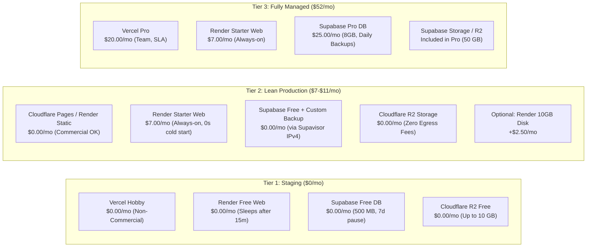

# Phase 4P-F — Infrastructure Cost Analysis & Budget Modeling

**Project:** Shri Sanwariya Road Lines (SSRL)  
**Repository:** `D:\Shri Sanwariya RO\SSRL`  
**Phase:** 4P-F (Integration Preparation)  
**Status:** Cost Estimation & Financial Guardrails  
**Production Deployment Gate:** STRICTLY LOCKED  

---

## 1. Executive Summary & Cost Philosophy

In compliance with Phase 4P-F guidelines, the hosting infrastructure for Shri Sanwariya Road Lines (SSRL) prioritizes **free tiers first**, introducing paid infrastructure only where technical constraints (cold starts, ephemeral data loss) or legal licensing terms (commercial use prohibitions) strictly require it.

This document models three distinct deployment tiers:
1. **Tier 1 — Pure Free-Tier Staging ($0.00 / month):**  
   Designed for technical verification, integration testing, and non-commercial validation.
2. **Tier 2 — Cost-Optimized Commercial Production ($7.00 – $11.00 / month):**  
   Eliminates backend cold starts and filesystem volatility while remaining 100% compliant with provider commercial terms at minimal cost.
3. **Tier 3 — Fully Managed Enterprise Production ($52.00 / month):**  
   Employs premium commercial tiers across Vercel, Render, and Supabase with automated point-in-time recovery and priority SLAs.

---

## 2. Infrastructure Deployment Tiers

---

## 3. Detailed Cost Breakdown by Tier

### 3.1 Tier 1: 100% Free Staging / Non-Commercial Testing
**Total Monthly Cost: $0.00 / month**

| Component | Provider & Tier | Monthly Cost | Allocated Quota & Limits | Operational Caveats & Trade-offs |
| :--- | :--- | :--- | :--- | :--- |
| **Frontend** | Vercel Hobby | $0.00 | 100 GB bandwidth, 6,000 build mins | **Non-commercial use only** (ToS §2.3). Valid only for testing. |
| **Backend** | Render Free Web Service | $0.00 | 750 instance hours/month, 512 MB RAM | **Spins down after 15m inactivity; 50–60s cold start latency.** Ephemeral disk. |
| **Database** | Supabase Free Tier | $0.00 | 500 MB database disk, 2 GB egress | **Pauses after 7 days inactivity.** No native automated daily backups. |
| **Database Pooler**| Supavisor Session Mode | $0.00 | Shared pooler (Port 5432, IPv4) | Resolves Render IPv4 constraint at zero cost. |
| **Document Storage**| Cloudflare R2 Free | $0.00 | 10 GB storage, $0 egress fees | Private S3-compatible bucket; stream via backend API. |
| **Disaster Recovery**| SSRL Local CLI Engine | $0.00 | Manual or scheduled CLI runner | Produces verified `pg_dump` and SHA-256 manifests. |
| **TOTAL** | | **$0.00 / mo** | | **Acceptable strictly for staging and pre-flight validation.** |

---

### 3.2 Tier 2: Cost-Optimized Commercial Production (Recommended)
**Total Monthly Cost: $7.00 – $11.00 / month**

This architecture solves the two fatal flaws of free-tier hosting for a logistics business:
1. Eliminates backend cold starts (Render Starter at $7.00/mo keeps the API permanently warm).
2. Complies with commercial terms without paying $20/user/mo for Vercel (using Cloudflare Pages or Render Static Site).

| Component | Provider & Plan | Monthly Cost | Allocated Quota & Limits | Operational Characteristics |
| :--- | :--- | :--- | :--- | :--- |
| **Frontend** | Cloudflare Pages (or Render Static Site) | $0.00 | **Unlimited bandwidth**, unlimited requests | **100% compliant with commercial use.** Fast global edge CDN. |
| **Backend** | Render Starter Web Service | $7.00 | 0.5 vCPU, 512 MB RAM, always-on | **Zero cold starts.** Instant response time for mobile users. |
| **Database** | Supabase Free + SSRL Backup Engine | $0.00 | 500 MB database, shared pooler | Independent daily backup keeps database active (prevents 7d pause). |
| **Database IPv4** | Supavisor Session Pooler (Port 5432) | $0.00 | Dual-stack IPv4/IPv6 support | Persistent connection supporting deferred triggers and sessions. |
| **Document Storage**| Cloudflare R2 | $0.00 | 10 GB free forever, zero egress | Ample for thousands of transport PODs and bill PDFs. |
| **Disaster Recovery**| SSRL Backup CLI + GitHub Actions | $0.00 | Daily cron execution + encrypted archive | Full offsite database and storage disaster recovery. |
| *(Optional Addon)* | Render Persistent Disk (10 GB) | +$2.50 | 10 GB local SSD storage | Optional if keeping POSIX filesystem storage instead of R2. |
| *(Optional Addon)* | Supabase Dedicated IPv4 Addon | +$4.00 | Dedicated IPv4 address | Optional direct DB connection bypass (if not using Supavisor). |
| **TOTAL** | | **$7.00 – $11.00 / mo** | | **Production-grade reliability at minimal commercial cost.** |

---

### 3.3 Tier 3: Fully Managed Enterprise Commercial Production
**Total Monthly Cost: $52.00 / month**

Designed for organizations requiring turnkey managed infrastructure, guaranteed SLAs, and official point-in-time recovery.

| Component | Provider & Plan | Monthly Cost | Allocated Quota & Limits | Operational Characteristics |
| :--- | :--- | :--- | :--- | :--- |
| **Frontend** | Vercel Pro | $20.00 | 1 TB bandwidth, multi-environment | Full Vercel platform, commercial license, team collaboration. |
| **Backend** | Render Starter Web Service | $7.00 | 0.5 vCPU, 512 MB RAM, always-on | Always-on Node.js API with automated health checks. |
| **Database** | Supabase Pro Plan | $25.00 | 8 GB database, 250 GB egress, 100k MAU | **Never pauses.** Daily automated backups with 7-day retention. |
| **Database IPv4** | Supavisor Session Pooler (Port 5432) | Included in Pro | Dual-stack IPv4/IPv6 support | Full transaction & session compatibility. |
| **Document Storage**| Supabase Storage (or Cloudflare R2) | Included in Pro | 50 GB storage included in Pro plan | Integrated private bucket with backend streaming. |
| **Disaster Recovery**| Supabase Automated Daily Backups | Included in Pro | 7-day rolling snapshots + SSRL CLI | Dual-layer disaster recovery (cloud native + independent CLI). |
| **TOTAL** | | **$52.00 / mo** | | **Enterprise SLA, hands-off backups, and scale headroom.** |

---

## 4. Resource Quotas, Expansion Triggers & Overage Rates

To ensure zero surprise invoices, all resource limits, overage fees, and scaling triggers are documented below.

| Provider / Resource | Included Quota | Overage Trigger | Overage Unit Price | Risk Mitigation / Guardrail |
| :--- | :--- | :--- | :--- | :--- |
| **Render Bandwidth** | 100 GB / month | Outbound traffic > 100 GB | $0.10 / GB | Document downloads stream compressed PDFs/images. Static assets served by CDN. |
| **Render Memory** | 512 MB RAM | Process heap > 512 MB | Container restarts (OOM) | Memory leaks prevented; Express streaming does not buffer large files in RAM. |
| **Supabase Database Size (Free)**| 500 MB | Total table size > 500 MB | Database set to read-only | SSRL schema is lean: 50,000 trips consume ~35 MB of table data. |
| **Supabase Database Size (Pro)** | 8 GB included | Total table size > 8 GB | $0.125 / GB / month | Historical audit logs can be archived to cold storage if needed. |
| **Supabase Egress Bandwidth** | 2 GB (Free) / 250 GB (Pro) | API / DB egress exceeded | Free: blocked / Pro: $0.09/GB | DB is accessed only by backend API, minimizing egress. |
| **Cloudflare R2 Storage** | 10 GB / month free | Stored files > 10 GB | $0.015 / GB / month | 10 GB holds ~20,000 scanned POD documents (avg 500 KB each). |
| **Cloudflare R2 Egress** | Unlimited | None | **$0.00 (Zero Egress Fees)**| No bandwidth charges regardless of download volume. |
| **Vercel Bandwidth (Pro)** | 1 TB / month | Bandwidth > 1 TB | $40 / 100 GB | Frontend bundle is ~600 KB gzip; 1 TB supports 1,600,000+ page views. |

---

## 5. Cost-Control Guardrails & Operational Recommendations

### 5.1 Immediate Recommendations for Staging (Phase 4P-F Execution)
1. **Zero-Spend Constraint:** Maintain Tier 1 ($0.00/month) for the entirety of staging validation. Do not input credit card details into Supabase or Render unless verifying plan upgrade mechanics.
2. **Supavisor Utilization:** Use Supavisor on Port 5432 (`aws-0-[region].pooler.supabase.com:5432`) to achieve full IPv4 connectivity from Render to Supabase at $0 cost (avoiding the $4/mo Supabase Dedicated IPv4 Addon).
3. **Private Object Storage:** Provision a free Cloudflare R2 bucket (`ssrl-staging-documents`) to eliminate the need for paid Render Persistent Disks ($2.50/mo + $7/mo instance requirement).

### 5.2 Transition to Production Recommendations
1. **Backend Compute:** Upgrade Render from Free to **Starter ($7.00/month)** upon production go-live. Eliminating the 50-second cold start is essential for operational transport staff and drivers.
2. **Frontend Hosting:** Host production frontend on **Cloudflare Pages ($0.00/month)** or **Render Static Site ($0.00/month)** to ensure full compliance with commercial licensing terms without incurring the $20/user/mo Vercel Pro seat fee.
3. **Disaster Recovery Automation:** Rely on the existing SSRL backup engine (`npm run backup`) run via a daily scheduled runner (e.g. GitHub Actions with encrypted artifact upload). This keeps the Supabase Free database active (preventing 7-day pause) while providing independent offsite disaster recovery at $0 additional cost.

---

## 6. Financial Summary Table

| Metric / Scenario | Staging Environment | Lean Commercial Production | Enterprise Commercial Production |
| :--- | :--- | :--- | :--- |
| **Monthly Compute** | $0.00 | $7.00 | $7.00 |
| **Monthly Frontend** | $0.00 | $0.00 | $20.00 |
| **Monthly Database** | $0.00 | $0.00 | $25.00 |
| **Monthly Storage** | $0.00 | $0.00 | $0.00 |
| **Estimated Monthly Total** | **$0.00 / month** | **$7.00 – $11.00 / month** | **$52.00 / month** |
| **Annualized Cost** | **$0.00 / year** | **$84.00 – $132.00 / year** | **$624.00 / year** |
| **Commercial License Status** | Staging / Non-prod | Fully Compliant | Fully Compliant |
| **Cold Starts** | 50 – 60 seconds | 0 seconds | 0 seconds |
| **Persistence Guarantee** | Decoupled R2 storage | Decoupled R2 storage | Turnkey automated backups |
