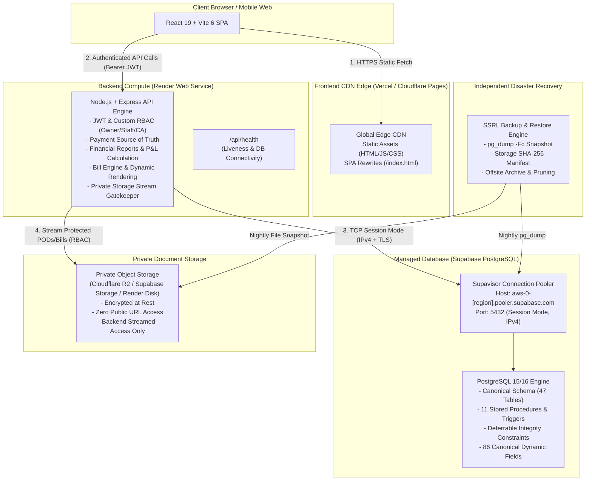

# Phase 4P-F — Hosting Architecture & Provider Comparison

**Project:** Shri Sanwariya Road Lines (SSRL)  
**Repository:** `D:\Shri Sanwariya RO\SSRL`  
**Phase:** 4P-F (Integration Preparation)  
**Status:** Audit & Integration Analysis  
**Production Deployment Gate:** STRICTLY LOCKED  

---

## 1. Executive Summary & Target Architecture

This document provides a rigorous, code-grounded comparative evaluation of the selected hosting providers (**Render**, **Vercel**, **Supabase**) alongside storage and backup alternatives for Shri Sanwariya Road Lines (SSRL).

### 1.1 Core Architecture Topology

The application architecture decouples the frontend presentation layer, backend business and security logic, database management, and private document storage while preserving all source-of-truth rules defined in `AGENTS.md`.

### 1.2 Fundamental Architecture Invariants

1. **Backend as Sole Business & Security Gatekeeper:**  
   The frontend communicates exclusively with the Express backend API. No database credentials, Supabase service-role keys, or direct storage write/read keys are ever exposed to the client browser.
2. **Payment Module Source of Truth (`AGENTS.md` §3.1):**  
   All money movement is strictly recorded in the `payments` and `payment_allocations` tables. No independent financial ledgers are created in external services or Supabase client triggers.
3. **Canonical Schema Integrity:**  
   The schema consists of 47 tables, 11 stored procedures, 29 triggers, and 86 canonical dynamic fields. Migrations are executed solely via `backend/src/scripts/migrate.ts`. Supabase client libraries (e.g. `@supabase/supabase-js`) are not introduced into the runtime, preventing vendor lock-in.
4. **Document Access Security (`AGENTS.md` §16):**  
   Documents (POD scans, bill PDFs, vehicle RC/fitness documents) are stored privately and streamed exclusively through `GET /api/documents/:id/file` after verifying authentication and RBAC permissions. Public bucket access is strictly prohibited.

---

## 2. Component-by-Component Comparative Analysis

### 2.1 Frontend Hosting: Vercel vs Alternatives

The SSRL frontend is built with **React 19**, **Vite 6**, **Tailwind CSS**, and **React Router DOM 7**. It compiles to pure static assets (`dist/`) requiring an edge CDN and SPA history API fallback.

| Feature / Metric | Vercel Hobby (Free) | Vercel Pro ($20/user/mo) | Cloudflare Pages ($0/mo) | Render Static Site ($0/mo) |
| :--- | :--- | :--- | :--- | :--- |
| **Commercial Terms** | **Non-commercial ONLY** (ToS §2.3) | **Commercial use permitted** | **Commercial use permitted** | **Commercial use permitted** |
| **Suitability for SSRL** | **Staging / Testing Only** | Production Ready | Production Ready (Recommended Free Alt) | Production Ready |
| **Bandwidth Limit** | 100 GB / month | 1 TB / month | **Unlimited** | 100 GB / month |
| **Build Minutes** | 6,000 mins / month | 24,000 mins / month | Unlimited builds (1 concurrent) | 100 mins / month |
| **Custom Domains** | Supported (SSL included) | Supported (SSL included) | Supported (SSL included) | Supported (SSL included) |
| **Routing / SPA Fallback** | `vercel.json` rewrites | `vercel.json` rewrites | `_redirects` or dashboard | Native SPA rewrite toggle |
| **DDoS & Edge CDN** | Anycast CDN | Enterprise Anycast CDN | Cloudflare Global Anycast | Fastly / Cloudflare Edge |
| **Team Collaboration** | 1 user | Multi-user / RBAC | Unlimited seats | Multi-user |

#### Critical Findings on Frontend Hosting:
- **Vercel ToS Constraint:** Section 2.3 of the Vercel Terms of Service strictly prohibits commercial activity on the Hobby plan. Because SSRL is an active logistics enterprise managing commercial transport operations, deploying production on Vercel Hobby creates legal and operational termination risks.
- **Staging vs Production Recommendation:**  
  - **Staging Environment:** Vercel Hobby is permissible and zero-cost for technical staging, pre-flight verification, and synthetic test runs.
  - **Production Environment:** Vercel Pro ($20/month) if Vercel deployment tooling is required, OR Cloudflare Pages / Render Static Site ($0/month, unlimited bandwidth, fully licensed for commercial use).

---

### 2.2 Backend Hosting: Render Web Service

The backend is an Express application running on Node.js 20+. It handles JSON payloads, cryptographic operations (`bcrypt`, `jsonwebtoken`), database pooling (`pg.Pool`), and file streaming.

| Feature / Metric | Render Free Tier | Render Starter ($7.00/mo) | Render Standard ($25.00/mo) |
| :--- | :--- | :--- | :--- |
| **Always-On Execution** | **No** (Sleeps after 15m inactivity) | **Yes** (24/7 continuous) | **Yes** (24/7 continuous) |
| **Cold Start Latency** | **50 – 60 seconds** | **0 seconds (Instant)** | **0 seconds (Instant)** |
| **CPU / RAM** | 0.1 vCPU / 512 MB RAM | 0.5 vCPU / 512 MB RAM | 1.0 vCPU / 2 GB RAM |
| **Monthly Uptime Hours** | 750 free hours (shared) | Unlimited | Unlimited |
| **Filesystem Persistence** | **Ephemeral** (Wiped on restart) | **Ephemeral** (Persistent Disk optional) | **Ephemeral** (Persistent Disk optional) |
| **Persistent Disk Support** | **Not supported** | Supported ($0.25/GB/mo) | Supported ($0.25/GB/mo) |
| **Custom Domains & SSL** | Free automated Let's Encrypt | Free automated Let's Encrypt | Free automated Let's Encrypt |
| **Health Checks** | Supported (`/api/health`) | Supported (`/api/health`) | Supported (`/api/health`) |
| **Zero-Downtime Deploys** | Supported | Supported | Supported |

#### Critical Findings on Backend Hosting:
- **Cold Starts:** On Render Free, services spin down after 15 minutes of inactivity. When a driver or staff member opens the app, the initial request experiences a 50–60 second delay while the container spins up. This is acceptable for staging, but unviable for daily commercial operations.
- **Ephemeral Filesystem:** On both Free and Starter plans, the root container filesystem is ephemeral. Any files saved to local disk (e.g. uploaded POD images or generated bill PDFs) are permanently lost whenever a new deployment occurs or the container restarts.
- **Persistent Disk Limitation:** While Render Starter supports adding a Persistent Disk ($0.25/GB/mo), disks can only attach to a single container instance. This prevents zero-downtime rolling deploys and horizontal scaling. Therefore, decoupled private object storage is strongly recommended over a local persistent disk.

---

### 2.3 Database Hosting: Supabase Managed PostgreSQL

Supabase provides a managed PostgreSQL environment (version 15/16) with extensions, connection pooling via Supavisor, and SSL encryption.

| Feature / Metric | Supabase Free Tier | Supabase Pro ($25.00/mo) |
| :--- | :--- | :--- |
| **Database Disk Size** | 500 MB | 8 GB included ($0.125/GB overage) |
| **Compute / RAM** | Shared 2-core / 1 GB RAM | Shared 2-core / 1 GB RAM (Dedicated available) |
| **Project Inactivity Pause** | **Pauses after 7 days of inactivity** | **Never pauses** |
| **Automated Daily Backups**| **None** (Manual pg_dump only) | **Yes** (7-day retention + PITR available) |
| **Egress Bandwidth** | 2 GB / month | 250 GB / month included |
| **Connection Pooling** | Supavisor included | Supavisor included |
| **IPv4 Address Support** | **IPv6 default** (IPv4 via pooler or +$4/mo) | **IPv6 default** (IPv4 via pooler or +$4/mo) |
| **Extensions Supported** | `pgcrypto`, `uuid-ossp`, etc. | `pgcrypto`, `uuid-ossp`, etc. |

#### Critical Findings on Database Hosting:
1. **The IPv4 / IPv6 Network Constraint:**
   - Render's outbound network infrastructure is strictly **IPv4**.
   - Supabase direct database connection strings (`db.[project-ref].supabase.co:5432`) resolve strictly to **IPv6**.
   - Attempting a direct connection from Render to Supabase results in `ETIMEDOUT`.
   - **Resolution:** Supabase's connection pooler (**Supavisor**) at `aws-0-[region].pooler.supabase.com` supports **IPv4 dual-stack routing**.
2. **Supavisor Mode Selection (Session vs Transaction):**
   - **Port 5432 (Session Mode):** Allocates a full PostgreSQL backend per client connection. Supports prepared statements, temporary tables, session variables (`SET LOCAL srl.recalculating = 'true'`), and PostgreSQL deferred constraint triggers (`DEFERRABLE INITIALLY DEFERRED`). **This is the mandatory connection mode for SSRL.**
   - **Port 6543 (Transaction Mode):** Returns connections to the pool immediately after each transaction block. Breaks session configuration, prepared statements, and triggers. Prohibited for SSRL.
3. **Supabase Free Inactivity Pausing:**
   - Free tier databases are automatically paused after 7 days of zero activity. Resuming requires an Owner to log into the Supabase web dashboard and wait 1–2 minutes.
   - For SSRL, our independent automated backup runner (`npm run backup`) can be scheduled via a lightweight daily cron job to both keep the database active and take offsite backups.

---

### 2.4 Private Document Storage: Comparative Evaluation

SSRL stores confidential business documents including Proof of Delivery (POD) scans, signed Lorry Receipts (LR), vehicle fitness certificates, and generated Bill PDFs.

| Storage Solution | Cost Model | S3 API Compatible | Scalability & Rolling Deploys | Ingress / Egress Fees | Backend Stream Security |
| :--- | :--- | :--- | :--- | :--- | :--- |
| **Render Ephemeral Disk** | $0 | No | Zero persistence | $0 | Incompatible (Data loss on deploy) |
| **Render Persistent Disk** | $0.25 / GB / mo (Requires $7 Starter) | No | Single instance only; blocks rolling deploys | $0 | High (Local POSIX filesystem) |
| **Cloudflare R2 (Recommended)** | **$0 up to 10 GB** ($0.015/GB thereafter) | **Yes** | **Unlimited**; decoupled from compute | **$0 (Zero Egress Fees)** | **Highest (Private S3 stream via backend)** |
| **Supabase Storage** | $0 up to 1 GB ($0.021/GB on Pro) | Yes (via S3 protocol) | High | $0 egress on Free up to 2 GB | High (Private bucket + backend stream) |
| **AWS S3** | Free 5 GB (12 mo only), then $0.023/GB | Yes | Unlimited | $0.09 / GB egress | High (Private bucket + backend stream) |

#### Recommendation on Document Storage:
- **Cloudflare R2** is the premier choice: 10 GB free storage forever, $0 egress fees worldwide, standard S3 API compatibility, and full decoupling from Render instances.
- **Supabase Storage** is a viable alternative if consolidating within the Supabase dashboard, but has a strict 1 GB free storage limit.
- **Render Persistent Disk** is acceptable only if an S3 adapter cannot be enabled, but imposes instance-locking and prevents rolling zero-downtime updates.

---

## 3. Disaster Recovery & Backup Architecture

### 3.1 Independence from Cloud Providers
SSRL does not rely on proprietary cloud provider backup tools. All disaster recovery is powered by the battle-tested, locally validated tooling developed in Phases 4P-C and 4P-E:

1. **Database Snapshot (`backend/src/scripts/backup.ts`):**  
   Executes `pg_dump -Fc` directly over the TLS-encrypted Supavisor connection (Port 5432). The resulting custom-format archive preserves all schema objects, sequences, triggers, and table data.
2. **Storage Snapshot:**  
   Captures physical storage documents, computes individual SHA-256 hashes, and records byte counts.
3. **Cryptographic Verification:**  
   Verifies dump integrity via `pg_restore -l` and generates an immutable `manifest.json` containing total size, file counts, and archive SHA-256 checksums.
4. **Deterministic Restoration (`backend/src/scripts/restore.ts`):**  
   Executes `pg_restore --clean --if-exists`, verifies dynamic field counts (86 canonical definitions), and re-indexes all operational tables.

---

## 4. Architectural Decision Summary Matrix

| Domain | Staging Environment Choice | Production Environment Choice | Key Rationale |
| :--- | :--- | :--- | :--- |
| **Frontend** | Vercel Hobby ($0) | Cloudflare Pages ($0) OR Vercel Pro ($20) | Vercel Hobby ToS allows staging/testing but prohibits commercial production. Cloudflare Pages offers free commercial use with unlimited bandwidth. |
| **Backend** | Render Free Web Service ($0) | Render Starter ($7/mo) | Free tier allows zero-cost verification; Starter eliminates 50s cold starts and provides 100% SLA for daily operations. |
| **Database** | Supabase Free Project ($0) | Supabase Free ($0 + custom backup) OR Pro ($25/mo) | Supavisor port 5432 provides IPv4 compatibility and preserves triggers/transactions. SSRL's native backup CLI removes dependency on Supabase Pro backups. |
| **Storage** | Cloudflare R2 Free ($0) | Cloudflare R2 ($0 – $1/mo) | 10 GB free forever, zero egress fees, decoupled from compute for zero-downtime rolling deploys. |
| **Disaster Recovery** | SSRL CLI Backup/Restore | SSRL CLI Backup/Restore + Offsite Archive | Deterministic, audited, provider-neutral recovery with SHA-256 verification. |

---

## 5. Review & Approval Gate

This architecture comparison has been prepared in accordance with `AGENTS.md` and Phase 4P-F specifications. No external accounts, databases, or services have been created. Proceed to `docs/PHASE_4P_F_INTEGRATION_PLAN.md` for the step-by-step staging operational workflow.
